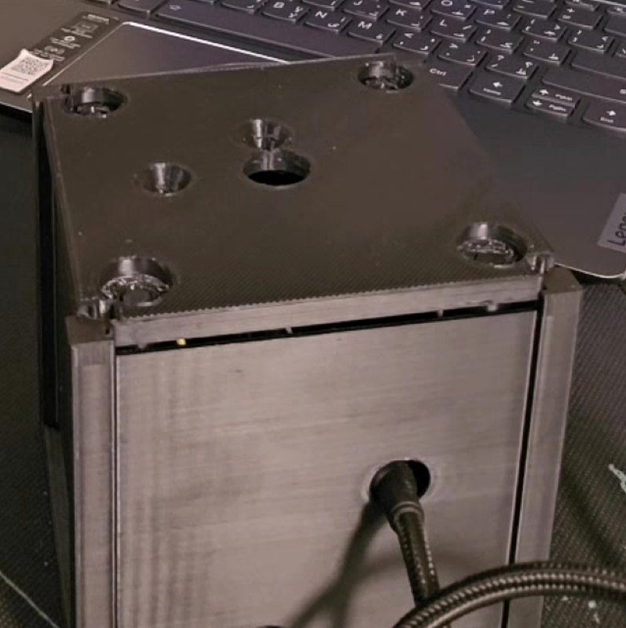
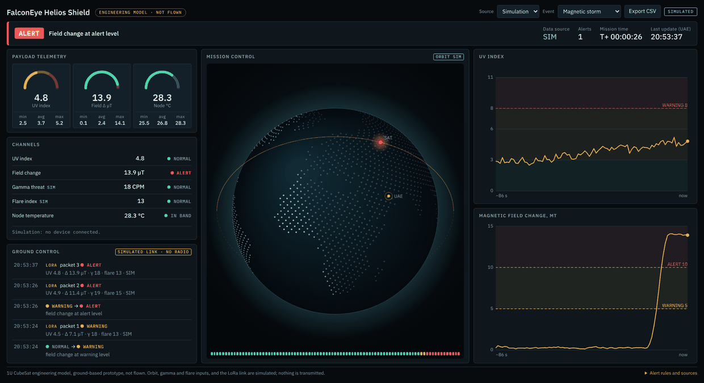

  

I work across the stack. Most of what I build takes a reading from the physical world — satellite imagery, CubeSat telemetry, a camera on a moving car — and turns it into something a person can act on.

## Helios Shield

A 1U CubeSat engineering model that measures UV and magnetic disturbance, logs it on board, and warns a ground operator within seconds of a limit being crossed. Built with the **FalconEye** team for SatForge 2026.

<table>
<tr>
<td width="35%" valign="top">
  
</td>
<td width="65%" valign="top">
  
</td>
</tr>
</table>

- An ESP32 reads a UV module and a 3-axis magnetometer every 2 s, appends each packet to microSD, and posts it over authenticated HTTPS
- A Vercel serverless function stores the latest packet in Upstash Redis; the browser dashboard polls it and raises the alert level within seconds
- Alert thresholds, stale-link detection and out-of-range faults are all computed on the ground, so limits change without re-flashing the firmware
- Verified on the bench: HTTP 200 with matching sequence numbers, live feed in the browser. The UV index stays switched off until it is calibrated against a reference — the firmware reports raw millivolts instead of guessing

**[Repository](https://github.com/inshal8717/HeliosShield_by_FalconEye)** · **[Live dashboard](https://helioshield-iota.vercel.app)**

## Other work

<table>
<tr>
<td width="50%" valign="top">

### [GreenBytes (Duroob)](https://github.com/inshal8717/GreenBytes)

Community tourism marketplace connecting visitors with farmers, guides and local businesses in the Al Qua'a region of the UAE. Built for the Tatweer Hackathon 2026.

- Role-based marketplace across tourist, farmer, guide and local business, with a bilingual EN/AR interface
- Google Maps with farmer-drawn safe-zone polygons, and a booking flow that detects time-slot conflicts
- An evening planner powered by Gemini that generates desert itineraries

**[Live](https://duroobtourism.vercel.app)** · **[Demo video](https://youtu.be/kawjYLrZvtg)**

</td>
<td width="50%" valign="top">

### [EmergencyConnectUAE](https://github.com/inshal8717/EmergencyConnectUAE)

Emergency-services coordination platform that puts dispatchers, responders, hospitals and admins on one incident picture.

- Geospatial incident mapping on PostgreSQL with PostGIS spatial indexing
- Real-time incident management, responder assignment and routing, hospital resource tracking
- MFA and role-based access control across five user roles, via Supabase

</td>
</tr>
<tr>
<td width="50%" valign="top">

### [Satellite Change Detection](https://github.com/inshal8717/self-supervised-satellite-change-detection-train)

PyTorch pipeline that learns Sentinel-2 image representations from unlabelled imagery using temporal contrastive pretraining, so no human labels are needed for training.

- Dense feature-distance change maps, with unsupervised Otsu thresholding and morphological cleanup
- Real before/after pairs pulled from Microsoft Planetary Computer and co-registered to a UTM grid
- Streamlit dashboard with change heatmaps, binary masks, IoU/F1/AUROC metrics and tiled inference for large scenes

</td>
<td width="50%" valign="top">

### [Autonomous Car Simulation](https://github.com/inshal8717/AutonomousCarSimulation)

CPU-only lane-following and traffic-light control for ROS 2 Jazzy and Gazebo Harmonic — no GPU and no neural nets required.

- Classical OpenCV and NumPy perception driving a PID steering controller
- Supervisor state machine with failsafe watchdogs, an offline evaluator and quantified performance metrics
- 43 tests covering the complete pipeline

</td>
</tr>
</table>

## Stack

Languages
&nbsp;

Machine learning and vision
&nbsp;

Platforms and data
&nbsp;

Robotics and embedded
&nbsp;

## Reach me

<!-- Add email / LinkedIn here when ready -->
